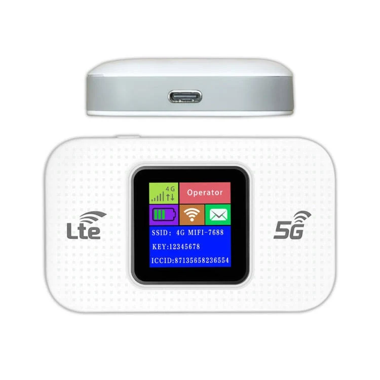

# MF68E Custom Firmware

Custom firmware for the **MF68E mobile Wi-Fi router**, based on **OpenWrt**.
This project adds a new web UI, device controls and features tailored to the
MF68E's modem, display and power button. Its firmware and installation workflow
are specific to the MF68E, rather than a generic build for MSM8916 devices.

Highlights include:

- **New MiFi web UI** with desktop sidebar navigation, a mobile drawer, custom
  login and consistent styling across LuCI pages.
- **On-device display** with live status, transfer rates, full-screen Wi-Fi QR,
  SMS viewing and a ping-history sleep screen.
- **Modem and messaging tools** for SMS management and IMEI backup, changes,
  restoration and persistence verification.
- **Power-button gestures** for status, Wi-Fi sharing, the latest SMS and shutdown.
- **OpenVPN management** and an MF68E-specific build and experimental factory
  installation workflow.

See the feature and validation notes below for implementation details and the
limits of hardware testing.

## Table of Contents

- [About this project](#about-this-project)
- [Target device: MF68E](#target-device-mf68e)
- [Changes from original source](#changes-from-original-source)
- [Features](#features)
- [Prerequisites](#prerequisites)
- [Building](#building)
- [Installation](#installation)
  - [Install the latest MF68E build](#install-the-latest-mf68e-build)
  - [Flashing from OEM Firmware](#flashing-from-oem-firmware)
  - [Accessing Boot Modes](#accessing-boot-modes)
- [Troubleshooting](#troubleshooting)
  - [No Network / Modem Stuck at Searching](#no-network--modem-stuck-at-searching)
- [Roadmap](#roadmap)
- [Credits](#credits)

---

## About this project

OpenWrt provides the Linux networking platform, package management and LuCI
administration framework. This project builds on that foundation with a custom
MF68E experience: a redesigned interface, new applications, display behavior
and hardware controls. The additions and their source locations are documented
in [Changes from original source](#changes-from-original-source).

## Target device: MF68E

The target is the **MF68E** (`generic-mf68e`), a Qualcomm MSM8916-based MiFi
router with a GC9107 display and battery monitoring. Boot, display and IMEI
persistence have been verified on the backed-up unit; peripheral and recovery
validation remains incomplete.

The repository retains inherited UZ801v3 (`yiming-uz801v3`) and UF02
(`generic-uf02`) profiles and flashing notes for reference. They are separate
device targets, not interchangeable MF68E firmware or installation paths.
M9S device support remains archived in [TBR](TBR/readme.md).

MF68E builds use `diffconfig_mf68e` and produce boot, system and sysupgrade images.
They omit the shared GPT, firmware ZIP and EDL flash script because those contain
UZ801-specific bootloader settings and a fixed partition layout. These images
expect the existing OpenWrt partition layout (rootfs at partition 14 and
rootfs_data at partition 15); they are not an OEM installation bundle.

A device-specific **experimental** factory installer is now available in
[`installer/mf68e/`](installer/mf68e/README.md) for the backed-up unit with ADB
serial `5664c9ea`. It builds MF68E-selected lk1st firmware and generates a migration
from that unit's stock GPT. It has been flashed with all writes verified and
OpenWrt 25.12.6 boot confirmed over SSH/HTTP. Full peripheral functionality and
physical EDL recovery remain untested. Do not use the shared
UZ801 EDL flasher for this unit. Hardware findings are recorded in
[`device-info.md`](device-info.md).

## Changes from original source

The comparison baseline is this repository's initial commit, **`ca13ba8`**
(`initial commit`). The comparison describes the current source tree, including the additions
collected in **`65164c1`** (`refactor`) and subsequent local UI refinements. The
original checkout already contained the MF68E target, GC9107
support, USB gadget configuration, modem firmware extraction, VPN packages and
UZ801/UF02 flashing support. This work extends that foundation with a tested
MF68E installation path, device controls and LuCI applications.

To inspect the implementation against the same baseline:

```sh
git diff --stat ca13ba8
git diff ca13ba8 -- packages/rmtfs packages/modem-identity
```

### Source map and behavior changes

| Area | Original behavior | Changes and source |
| --- | --- | --- |
| MF68E factory installation | Existing MF68E images expected an OpenWrt partition layout; the shared EDL flasher used UZ801 settings. | Added a device-specific boot-chain builder, GPT migration, bundle validation, verified flashing and recovery instructions in [`installer/mf68e/`](installer/mf68e/README.md). |
| IMEI management | No native IMEI CLI or dedicated LuCI page. | Added [`packages/modem-identity/`](packages/modem-identity/README.md) and [`packages/luci-app-modem-identity/`](packages/luci-app-modem-identity/): read, validate, generate, back up, change, restore and verify an identity through DIAG NV item 550. |
| Modem storage | `rmtfs` always used read-only backing storage, with a misleading comment about its `-r` option. | Added explicit read-only configuration, serialized restart, shutdown and storage-acknowledgement patches, and a pending-save guard in [`packages/rmtfs/`](packages/rmtfs/). |
| SMS | No dedicated SMS page or RPC service. | Added **Network → SMS**, inbox/sent views, periodic refresh and compose/send controls in [`packages/luci-app-sms/`](packages/luci-app-sms/README.md). |
| OpenVPN | Not selected in the MF68E image. | Added `openvpn-openssl` and `luci-app-openvpn` to [`diffconfig_mf68e`](diffconfig_mf68e) and the build selection checks. The upstream LuCI application adds **VPN → OpenVPN**, profile import, instance start/stop, and configuration pages. |
| LuCI appearance | Upstream Bootstrap navigation and branding. | Added [`packages/luci-theme-mifi/`](packages/luci-theme-mifi/README.md): desktop sidebar, mobile drawer, custom login, active navigation, accessible focus handling and shared page styling. |
| Device display | Logo/Wi-Fi QR page with basic operator, network, hostname and battery labels. | Added a live status dashboard, measured transfer rates, validated signal/battery readings, enlarged two-row IMEI and full-screen Wi-Fi QR in [`packages/router-display/`](packages/router-display/). |
| Power button | Double-click shut down the router; a separate hotplug handler woke the display on every release. | One handler now owns gestures: single press wakes status, double press opens Wi-Fi QR, triple press shows the latest received SMS, and a three-second hold followed by release shuts down. See [`rc.button.power`](packages/configs-mifi/files/rc.button.power). |
| Build selection | MF68E build checks covered the existing configuration, display and framebuffer packages. | [`diffconfig_mf68e`](diffconfig_mf68e) selects the new IMEI, SMS and theme packages; [`devenv/build-mf68e.sh`](devenv/build-mf68e.sh) verifies they remain selected after `make defconfig`. |
| Tests and records | The added features had no corresponding regression suites or device installation record. | Added installer, DIAG, storage, display, gesture, SMS and navigation tests, plus [`device-info.md`](device-info.md) and package-level documentation. |
| Local artifacts | No exclusions for the new backup/build workflow. | [`.gitignore`](.gitignore) excludes private `backups/`, generated `installer-output/` and Python bytecode caches. |

### Latest SMS on the device display

Press the power button three times quickly (no more than half a second between
releases) to display the newest received SMS. The view shows the sender and
wraps text to the 128×128 screen; long messages advance automatically, with a
page indicator. It remains bright for one minute before returning to the sleep ping graph.
A single press returns to status, a double press opens the Wi-Fi QR, and holding
the button for three seconds still shuts down the router.

The SMS snapshot is fetched when the view opens, so triple-press again to refresh.
Messages are selected by received timestamp, accounting for timezone offsets;
sent messages are excluded. No message is sent or deleted. The snapshot is kept
in a private RAM-backed file. An empty inbox or unavailable modem gets an explicit
screen message. The collector and renderer live in
[`packages/router-display/`](packages/router-display/); the gesture handler is
[`rc.button.power`](packages/configs-mifi/files/rc.button.power).

### OpenVPN management

The MF68E build includes `openvpn-openssl` with DCO disabled and the upstream LuCI application
`luci-app-openvpn`. Open **VPN → OpenVPN** (`/cgi-bin/luci/admin/vpn/openvpn`)
to import an `.ovpn` profile, create or edit instances, and start or stop them.
These pages use the MiFi theme's shared navigation and form styles. Their source
comes from the OpenWrt LuCI feed (`applications/luci-app-openvpn`); this repository
selects that package rather than maintaining a separate copy. The existing router
uses a locally signed TUN-mode package because no matching DCO kernel module
is available; the packaging source and validation notes are in
[`packages/openvpn-userspace/`](packages/openvpn-userspace/README.md).

Installing support does not establish a VPN connection. Configure a provider or
server profile, its credentials/certificates, and the appropriate firewall,
routing and DNS settings before enabling an instance. No default route, kill
switch, or provider account is configured automatically. A connection to an
external VPN server must be tested separately once a real profile is supplied.

### MF68E installation and recovery

The new installer is experimental and pinned to the backed-up unit identified in
its [README](installer/mf68e/README.md). It is not a general installer for every
router sold as MF68E. Its boot-chain builder pins source revisions and checks
firmware provenance. Bundle preparation checks the original backup and loader,
GPT CRCs and geometry, image hashes and payload fit before any hardware write.

The migration reuses stock system storage for `rootfs` at partition 14 and
userdata for `rootfs_data` at partition 15. It reorders GPT entries while
preserving the physical locations of radio/calibration partitions, and allocates
a larger TrustZone slot in an unused gap. It replaces the primary boot chain,
boot and root filesystem and resets the overlay. Writes are individually read
back and verified, with the primary GPT committed last. A journal records the
operation; incomplete writes are not blindly retried.

Preparation and validation are offline. Hardware writes require explicit device
selection and `--write`. Recovery uses the unit's original full eMMC backup and
tested loader. Physical EDL entry and full backup restoration remain untested.
See the installer documentation before using these tools.

### IMEI changes and the persistence fix

The native C tool discovers the modem's DIAG RPMsg controller, validates the
15-digit Luhn checksum and uses an expected-current-IMEI check to reject stale
requests. Before writing, it saves the complete original NV item in a private,
checksummed backup. It preserves the other NV bytes, sends one write, and checks
all returned bytes. A timed-out write is an unknown outcome and is never retried
automatically. Restore uses the same checks and backs up the value being replaced.
No security unlock, arbitrary NV-item editor or raw radio-partition patch is used.

**Generate IMEI** preserves the current eight-digit type allocation code,
randomizes the six-digit serial using browser cryptographic randomness and
calculates the check digit. It only fills the input; it does not change the modem
or establish that the generated serial is globally unassigned.

The page replaces the manual **Enable editing → refresh → change → finish →
refresh** sequence with **enter/generate → Apply & restart → automatic
verification**:

1. Read the current identity again and prepare writable modem storage.
2. Back up NV item 550, write the requested identity once and verify live readback.
3. Record the storage daemon PID, acknowledged-write sequence and durable byte
   count after readback; request its existing QMI force-sync indication.
4. Wait for a later successful backing-store acknowledgement. The UI shows a
   countdown for up to five minutes; modem startup has a separate readiness wait.
5. Return storage to read-only mode, restart the modem and reread its actual IMEI.
6. Report success only when the identity survives that restart.

The important finding was that immediate NV readback preceded the actual disk
write. In the observed case, the later write arrived about 90 seconds afterward.
Restarting earlier discarded the change. The fix therefore waits for successful
`fdatasync`, not a fixed sleep or a successful write response alone.

The rmtfs patches also stop its `ENETRESET` recovery loop from restarting the
modem during shutdown, add a controlled force-sync signal, correct the caller-ID
encoding for that indication and propagate storage-sync failures. The init
script waits for the old daemon to exit before starting another, allows its
shutdown handshake to finish, and preserves `/etc/config/rmtfs` across upgrades.
Read-only storage remains the default.

RPC refuses a premature restart or another change while a save is pending. If
the storage wait expires, it leaves the writable daemon running to preserve the
live value. **Finish saving & restart** continues the wait without another NV
write. The new value was verified through modem and full-router restarts with
read-only storage and no startup reapply service. Full details are in the
[IMEI package notes](packages/modem-identity/README.md).

### Display and gesture details

The default status page now shows battery/charging state, recent signal quality,
network/operator, a single-line IMEI, the SIM phone number, and a live data-flow bar. Battery capacity is read from
sysfs; a voltage-derived fallback is marked as an estimate. Unknown or stale
readings remain unknown. Transfer rates use counter deltas and monotonic time,
with handling for missing interfaces, counter resets and interface changes.
The traffic interface can be selected in `/etc/config/display`.
The data-flow bar refreshes once per second while awake and measures combined
upload/download throughput; full scale defaults to 10 Mbps, configurable with
`display.display.traffic_scale_mbps`. Matching four-pixel bars and six-pixel
margins align battery, signal, and traffic indicators. No numeric percentages
or upload/download text rows are shown. The Qualcomm cellular driver reports
zero netdev counters even during traffic, so a dedicated nftables accounting
table supplies byte counts on this hardware. Its rules only count packets;
they do not change firewall decisions. Counter resets reinitialize the sample.


All 15 IMEI digits fit on one line, aligned with the phone number. The former bottom
interface-name line is removed. Wi-Fi QR uses the full 128 × 128 panel, black
modules on white, a quiet border and escaped credential characters. The QR page
stays bright for 30 seconds, then dim for another 30 seconds by default. Page
switching is temporary and does not repeatedly write the UCI configuration.

The sleep screen is a full-screen ping history graph, replacing the analog
clock. It reads the same RAM-backed one-hour history as the web dashboard and
redraws every ten seconds. The upper half shows live/stale status, successful
and failed probe percentages, and the last, average, minimum and maximum
successful response times. Percentages describe observed probes; unsampled
time is excluded. The lower half has 58 thin green bars with six-pixel margins.
Each grouped bar preserves peak successful latency; a timeout adds only a red
one-pixel marker at the baseline, never a full-height bar. A single press restores the status screen for one minute.

The display manager refreshes while awake without resetting its dim/off timers,
stops refreshing when off, cleans up timers/FIFO/PID state and renders a complete
frame before updating the framebuffer. The package now installs shared metric
helpers, declares ModemManager/jsonfilter dependencies, preserves display
configuration and loads the correct configuration section when stopping.
The old duplicate button hotplug dispatch is disabled; gesture state uses
monotonic time, and a missing display reader cannot block the button handler.
Power-on after shutdown still depends on the PMIC/bootloader and has not been
verified remotely.

### SMS, theme and validation boundaries

SMS uses ModemManager rather than a second modem driver. Its RPC ACL separates
reading and sending. Recipient and UTF-8 payload validation, private temporary
text files, bounded requests and retained drafts handle errors without silently
sending a message again. The page polls every 15 seconds. Real carrier sending
and receipt of a new incoming message remain untested.

The MiFi theme retains LuCI's native forms and permission-filtered menu data,
while replacing the surrounding navigation and styling status, network and
system pages consistently. Mobile navigation supports Escape, backdrop closing,
focus return and inaccessible hidden content. Bootstrap remains available as a
revert option. Theme and modem-identity layout checks cover mobile and desktop
sizes; see each package's README for the precise checks performed.

Regression suites cover installer geometry/readbacks and wrong-device rejection;
DIAG framing, backups and failed writes; durable-storage acknowledgement versus
read-only shadows and failed fsync; restart ordering; display metrics/timers and
button gestures; IMEI UI deadlines/pending saves; SMS validation/errors; and theme
navigation. Tests that need a compiler, prepared upstream rmtfs sources, an
OpenWrt userspace or Playwright document those requirements in their package
notes or test files. A mocked protocol or UI test does not establish carrier
connectivity or physical recovery.

### Source, images and the running device

The source changes and the bundled firmware images are different artifacts.
The tracked `bin/targets/msm89xx/msm8916/` manifest still lists `rmtfs 1.0-r1` and
`router-display 1.0-r1` and does not contain the new IMEI, SMS or MiFi theme packages.
Those images predate this change set. The running device received newer files
through staged deployment; the firmware release string alone does not identify
which custom packages are installed.

Build a fresh MF68E image to include all selected source changes, or deploy the
corresponding packages to an existing compatible installation. An upgrade clears
custom overlay files outside the saved configuration, so preserve those files
separately before using an older image. The tested sysupgrade retained the
hostname, network configuration and SSH key; the previous custom overlay was
subsequently restored from its backup.

Hardware verification is specific to this unit: OpenWrt boot, SSH/HTTP, writable
overlay, display rendering, a Wi-Fi AP interface and persistent IMEI changes were
observed. Complete Wi-Fi/cellular data traffic, real SMS delivery, physical EDL
recovery and full stock restoration remain separate validation tasks. Private
backups and generated tools/binaries stay in the ignored local directories and
are not a substitute for rebuilding the tracked source.

## Features

### Remote management

[`remote-manager/`](remote-manager/README.md) is a standalone Node.js 22+ server
with a vanilla JavaScript dashboard and no npm dependencies. It supports paired
routers, status, interfaces, wireless runtime controls and SMS through an
outbound HTTPS relay. **System → Remote management** in LuCI configures the
server URL and per-router token. MF68E builds include the feature, disabled by
default. The supplied `https://mifi.bohoosh.com` address is an example; deploy the
server and configure HTTPS before pairing. Hosting and API instructions are in
the [management app README](remote-manager/README.md).

### Voice call controls

**Network → Calls** lists incoming/outgoing calls and provides dialing, answer,
reject and hang-up controls. The standalone remote manager also includes Calls.
This is call control only: browser audio is unavailable and carrier voice/VoLTE
compatibility remains unverified. Live call listing and simulated controls were
checked without placing or answering real calls. See
[Calls package notes](packages/luci-app-calls/README.md).

### SMS messages

MF68E builds include **Network → SMS**, with incoming and sent messages, a
15-second automatic refresh, and a compose form. Sending requires LuCI write
permission. Failed sends retain the draft and are never retried automatically;
check the message state before sending again after a timeout. Long messages may
use multiple SMS and incur carrier charges. Messages remain managed by the
modem, without an additional persistent archive.

The page and RPC service were checked on the MF68E with ModemManager 1.24.0.
Automated UI tests and isolated backend tests cover reading, sending, Unicode,
input validation and errors. Real carrier sending and receipt of a new incoming
message have not been tested. See [SMS package notes](packages/luci-app-sms/README.md).

### Modem identity management

The MF68E build now includes a native `modem-identity` CLI and
**Network → Modem identity** LuCI page. They support IMEI validation, original-NV
backups, requested NV item 550 changes, readback verification and restore.
Apply & restart temporarily enables writable storage and restores read-only
mode after the save is acknowledged and verified.
The **Generate IMEI** button fills the input with a random serial and valid Luhn
check digit while preserving the current device's eight-digit type allocation
code. Generation does not change the modem; use **Apply & restart** to save and verify it.
On this unit, the requested IMEI survived a modem restart and full router reboot.
The save flow waits for an acknowledged backing-store write before restarting;
this can take several minutes. See [feature instructions](packages/modem-identity/README.md).

### Mobile navigation

MF68E builds select the [MiFi LuCI theme](packages/luci-theme-mifi/README.md), with
a mobile drawer, desktop sidebar and active-page navigation. It omits the theme
footer and OpenWrt logo branding while retaining LuCI's form components.

### Device button and display

- Single press: wake the status display.
- Double press within half a second: show a full-screen Wi-Fi connection QR code
  for 60 seconds. Single press returns to status.
- Triple press: show the latest received SMS for one minute; long messages page automatically.
- Hold for at least three seconds, then release: shut down the router.

Power-on from shutdown is controlled by the PMIC/bootloader and remains
unverified on this unit. The status display shows all IMEI digits on one line and omits the traffic-interface footer.

### Base features inherited from the original source

The original project advertises the following capabilities. They are not an
end-to-end validation claim for every MF68E peripheral.

- **Modem**: Fully functional with cellular connectivity
  - ModemManager Rx/Tx stats not displayed in LuCI (known issue)
- **WiFi**: Complete wireless support
- **USB Gadget Modes**: NCM, RNDIS, Mass Storage, ACM Shell
  - Configure via [UCI](packages/uci-usb-gadget/readme.md) or LuCI app
- **VPN Ready**: TUN driver and WireGuard pre-installed
- **LED Control**: Managed via `hotplug.d` scripts (sysfs-based, no extra packages)

### Storage & Recovery
- **SquashFS Root**: Compressed root filesystem
- **OverlayFS**: ext4 overlay partition for user data (formatted automatically via preinit)
- **Factory Reset**: `firstboot` mechanism enabled

### Additional Packages
- **Tailscale**: LuCI app available as standalone package (APK and IPK)

## Prerequisites

- An OpenWrt build environment and its native build dependencies, or Docker for
  the supplied container workflow. Docker is optional.
- Basic knowledge of Linux command line
- For flashing: [edl tool](https://github.com/bkerler/edl)

## Building

The commands below use the supplied Docker environment. The target and packages
can also be integrated into a native OpenWrt build tree. The current MF68E helper
uses container paths (`/repo` and `/home/builder/openwrt`); adapt those paths when
building natively. See the [source/image distinction](#source-images-and-the-running-device)
before reusing existing `bin/` artifacts.

### GitHub Actions (release builds)

GHA workflows automatically resolve the **latest OpenWrt 25.12.x** tag. Trigger manually from the Actions tab:

- **Build firmware**: `build.yml` — select a device (`uz801`, `uf02`, or `all`)
- **Build packages**: `build-package.yml` — builds `luci-app-tailscale`, `uci-usb-gadget`, and `luci-app-usb-gadget` in APK and IPK formats

### Local (snapshot builds)

1. Build the environment (defaults to OpenWrt `main`/snapshot):
```
cd devenv
docker compose build builder
```

2. Build the MF68E firmware:
```
docker compose run --rm builder bash /repo/devenv/build-mf68e.sh
```

To build a specific release locally:
```
OPENWRT_VERSION=v25.12.6 docker compose build builder
```

The MF68E helper checks the device and display package selections,
downloads sources, and builds with eight jobs (`BUILD_JOBS` overrides this).
Output is saved to `bin/targets/msm89xx/msm8916/` on the host.

> **Supported versions:** OpenWrt 25.12.x and current snapshots (kernel 6.12). OpenWrt 24.10.x (kernel 6.6) compiles but does not boot — the Makefile supports it via `KERNEL_FOR_24` (currently commented out) if someone wants to investigate further.

## Installation

### Install the latest MF68E build

These steps update **the backed-up device with serial `5664c9ea`, already running
OpenWrt with board name `generic,mf68e`**. Its initial factory migration is complete.
Use the MF68E image only. The commands below run on the host from the repository
root unless noted otherwise; connect the router by USB and keep power connected
throughout the upgrade.

#### 1. Build or locate the image

To build the current checkout against the validated OpenWrt 25.12.6 release:

```bash
cd devenv
OPENWRT_VERSION=v25.12.6 docker compose build builder
docker compose run --rm builder bash /repo/devenv/build-mf68e.sh
cd ..
```

If a fresh local build containing the required packages is already present, skip
the build commands. Check its manifest: the tracked images currently predate the
new features described above. Outputs
are in `bin/targets/msm89xx/msm8916/`. Use
`openwrt-msm89xx-msm8916-generic-mf68e-squashfs-sysupgrade.bin` for this update;
`boot.img` and `system.img` are separate factory-installer payloads.
The existing artifacts report revision `r33311-981c978eff`; rebuilding may change
their checksums. GitHub Actions' firmware workflow currently selects UZ801/UF02,
so use the local MF68E build procedure above for this device.

Verify the build outputs before transferring them:

```bash
(cd bin/targets/msm89xx/msm8916 && sha256sum -c sha256sums)
```

Every listed file should report `OK`. Keep the image and `sha256sums` from the
same build together.

#### 2. Check the router and save its configuration

The router is available at `192.168.1.1` over USB. Check its board identity:

```bash
ssh root@192.168.1.1 'cat /tmp/sysinfo/board_name; ubus call system board'
```

The board name must be `generic,mf68e`. Stop if it differs. Save a configuration
archive to the host before updating:

```bash
ssh root@192.168.1.1 'sysupgrade -b /tmp/mf68e-config-backup.tar.gz'
scp -O root@192.168.1.1:/tmp/mf68e-config-backup.tar.gz ./mf68e-config-backup.tar.gz
```

Keep this archive private. It contains configuration and credentials; it does
not replace the full stock eMMC and radio backups described in
[device-info.md](device-info.md).

#### 3. Transfer, validate and install

```bash
scp -O bin/targets/msm89xx/msm8916/openwrt-msm89xx-msm8916-generic-mf68e-squashfs-sysupgrade.bin root@192.168.1.1:/tmp/mf68e-sysupgrade.bin
sha256sum bin/targets/msm89xx/msm8916/openwrt-msm89xx-msm8916-generic-mf68e-squashfs-sysupgrade.bin
ssh root@192.168.1.1 'sha256sum /tmp/mf68e-sysupgrade.bin'
ssh root@192.168.1.1 'sysupgrade -T /tmp/mf68e-sysupgrade.bin'
```

Compare the two SHA-256 values; they must match. Continue only if the image test
succeeds. Do not use `-F` to bypass a rejected image.

```bash
ssh root@192.168.1.1 'sysupgrade /tmp/mf68e-sysupgrade.bin'
```

The SSH connection will close while the router writes the image and reboots.
Leave power connected and allow several minutes for it to return. The default
command requests configuration preservation. The project's upgrade hook clears
the overlay, so manually installed packages and other files outside the saved
configuration must be reinstalled or backed up separately. The tested upgrade
preserved the hostname, network configuration and SSH key; custom overlay
additions needed separate restoration.

For a clean installation, use `sysupgrade -n /tmp/mf68e-sysupgrade.bin` instead;
this discards configuration, including passwords and network settings.

After the router returns, reconnect USB if needed to renew the host's DHCP lease,
open http://192.168.1.1, and verify the running version:

```bash
ssh root@192.168.1.1 'ubus call system board; df -h /overlay'
```

If you preserved a different LAN address, reconnect at that address. After a clean
installation, set a root password through LuCI or `passwd`. Check the display,
Wi-Fi and cellular connection separately. A hardware sysupgrade, SSH/HTTP and
overlay operation have been verified on this unit. A Wi-Fi AP interface was
observed; complete Wi-Fi/cellular data traffic remains unverified.

#### Installing from stock Android

A stock Android device needs the device-specific GPT/bootloader migration before
it can use sysupgrade. Follow the full
[experimental MF68E factory installer instructions](installer/mf68e/README.md),
including backup verification, firmware preparation, explicit EDL flashing and
first boot. That installer is pinned to this unit's stock preflash snapshot;
do not rerun it on the already migrated device or reuse it for another unit.
Do not write OpenWrt images directly to stock partitions 14/15 or use the shared
UZ801 flasher on this device.

### Flashing from OEM Firmware

The shared flashing steps below apply to UZ801/UF02. For MF68E, use the
[device-specific instructions above](#install-the-latest-mf68e-build).

1. **Install EDL tool**: https://github.com/bkerler/edl
2. **Enter EDL mode**:
   - **UZ801v3**: See [PostmarketOS wiki guide](https://wiki.postmarketos.org/wiki/Zhihe_series_LTE_dongles_(generic-zhihe)#How_to_enter_flash_mode)

3. **Backup original firmware**:
   ```
   edl rf backup.bin
   ```

4. **Flash OpenWrt**:
   ```
   ./openwrt-msm89xx-msm8916-*-flash.sh
   ```

   > The script flashes entirely via EDL (no fastboot step). It automatically backs up radio partitions, writes the new GPT, firmware, boot and rootfs, and restores the backed-up partitions.

### Accessing Boot Modes

#### UZ801v3
- **Fastboot mode**: Insert device while holding the button
- **EDL mode**: Boot to fastboot first, then execute: `fastboot oem reboot-edl`

#### UF02
- **Fastboot mode**:
  - From OEM: `adb reboot bootloader`.
  - From OpenWrt: Enter `edl` and erase boot partition (`edl e boot`).
- **EDL mode**:
  - From OEM: `adb reboot bootloader`, flash `lk2nd` aboot. Reboot pressing the button.
  - From OpenWrt: Insert device while holding the button.

## Troubleshooting

### No Network / Modem Stuck at Searching

The modem requires region-specific MCFG configuration files.

#### Extract MCFG from Your Firmware

1. **Dump modem partition**:
   ```
   edl r modem modem.bin
   ```

2. **Mount and navigate**:
   ```
   # Mount modem.bin (it's a standard Linux image)
   cd image/modem_pr/mcfg/configs/mcfg_sw/generic/
   ```

3. **Select your region**:
   - `APAC` - Asia Pacific
   - `CHINA` - China
   - `COMMON` - Generic/fallback
   - `EU` - Europe
   - `NA` - North America
   - `SA` - South America
   - `SEA` - South East Asia

4. **Locate your carrier's MCFG**: Navigate to your telco's folder and find `mcfg_sw.mbn`. If your carrier isn't listed, use a generic configuration from the `common` folder.

#### Apply the Configuration

**Transfer to device** (capitalization matters!):
   ```
   scp -O mcfg_sw.mbn root@192.168.1.1:/lib/firmware/MCFG_SW.MBN
   # ... and reboot the device ...
   ```

## Roadmap

- [ ] Custom package server for msm89xx/msm8916
  - Note: Target-specific modules may require building from source via `make menuconfig`
  - The target-specific APK feed is automatically removed on first boot (msm89xx is not on downloads.openwrt.org)
- [ ] Investigate `lpac` for eSIM support
- [x] Memory expansion: `kmod-zram` + `zram-swap` enabled on all devices

## Credits

- **[@ghosthgy](https://github.com/ghosthgy/openwrt-msm8916)** - Initial project foundation
- **[@lkiuyu](https://github.com/lkiuyu/immortalwrt)** - MSM8916 support, patches, and OpenStick feeds
- **[@Mio-sha512](https://github.com/Mio-sha512/OpenStick-Builder)** - USB gadget and firmware loader concepts
- **[@AlienWolfX](https://github.com/AlienWolfX/UZ801-USB_MODEM/wiki/Troubleshooting)** - Carrier policy troubleshooting guide
- **[@gw826943555](https://github.com/gw826943555/luci-app-tailscale) & [@asvow](https://github.com/asvow)** - Tailscale LuCI application
